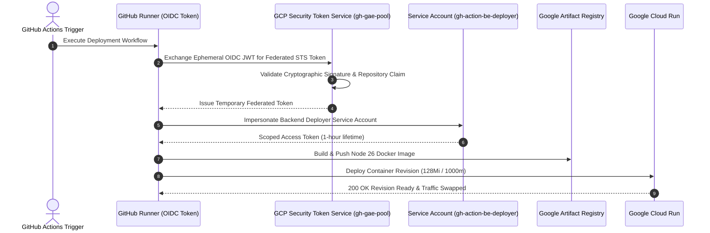
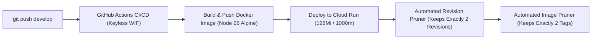
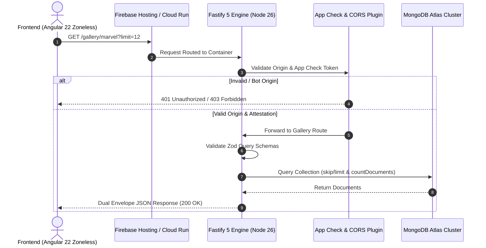

# ⚡ ms-generic-gallery

[](https://nodejs.org/)
[](https://fastify.io/)
[](https://www.typescriptlang.org/)
[](https://cloud.google.com/run)
[-00C853>)](https://cloud.google.com/run/pricing)
[-00B0FF>)](https://cloud.google.com/iam/docs/workload-identity-federation)
[](https://cloud.google.com/artifact-registry)
[](http://localhost:3000/documentation)
[](https://firebase.google.com/docs/app-check)
[](https://opensource.org/licenses/ISC)

A high-throughput, ultra-lean microservice engineered with **Node 26 Alpine**, **Fastify 5**, **TypeScript**, and **MongoDB Atlas**. Purpose-built for **Google Cloud Run** with a **128 MiB micro-footprint**, **V8 heap constraint tuning**, **scale-to-zero ($0 idle cost)**, **automated 2-version CI/CD pruning**, **keyless Workload Identity Federation (WIF)**, and **cryptographic Firebase App Check attestation**.

Serves as the high-concurrency, low-latency backend for [**prj-generic-gallery**](https://github.com/himanshusaraswat/prj-generic-gallery) (Angular 22 Zoneless + Signals).

---

## 🌟 Enterprise Engineering Wins

### 1. 🏎️ 128 MiB Cloud Run Micro-Footprint & V8 Heap Tuning

- **Cloud Run First Generation (`EXECUTION_ENVIRONMENT_GEN1`)**: Tuned to run in a minimal **128 MiB container** with 1000m vCPU and request-based CPU allocation (`cpu_idle = true`). Yields ultra-fast sub-800ms cold starts without Gen2 virtualization lag.
- **V8 Heap Constraint Optimization**: Injected `NODE_OPTIONS="--max-old-space-size=90"` into the container runtime. This instructs the V8 engine to trigger aggressive Mark-Sweep garbage collection cycles before approaching the 128 MiB container limit, keeping idle RSS memory under ~45 MiB and eliminating Out-of-Memory (OOM) crashes under concurrency spikes.
- **Fastify 5 Low-Overhead Engine**: Fastify's asynchronous plugin architecture and compiled route trees achieve 3x–5x lower memory overhead compared to traditional Express microservices.

### 2. 💰 Scale-to-Zero & $0 Monthly Idle Cost

- Configured with `min_instance_count = 0` and `max_instance_count = 2`.
- When inbound HTTP traffic ceases, Cloud Run scales active instances down to **0**.
- Fully covered by Google Cloud Run's Always-Free tier (2,000,000 free requests, 360,000 GiB-seconds, and 240,000 vCPU-seconds per month), resulting in **$0 hosting cost during idle and exploration phases**.

### 3. 🔐 Zero-Secret Workload Identity Federation (WIF)

- **Eliminates Static JSON Service Account Keys**: GitHub Actions runners never store or receive private credentials.
- **Cryptographic OIDC Token Exchange**: The runner requests a short-lived OpenID Connect JWT token from GitHub's token issuer (`token.actions.githubusercontent.com`), which Google Cloud's Security Token Service (`sts.googleapis.com`) validates against cryptographic JWKS public keys.
- **Granular Attribute Verification**: GCP STS verifies repository claims (`assertion.repository == 'himanshusaraswat/ms-generic-gallery'`) before issuing a temporary federated access token to impersonate the target deployment Service Account (`gh-action-be-deployer`).
- **Zero Rotation Overhead**: Because tokens expire in 15–60 minutes and exist purely in memory, there are zero static keys to rotate, leak, or manage.



### 4. 🧹 Automated 2-Revision & 2-Version CI/CD Pruning

Every deployment via GitHub Actions ([`deploy-to-dev-stg-on-develop-merge.yml`](.github/workflows/deploy-to-dev-stg-on-develop-merge.yml)) automatically executes garbage collection:

- **Cloud Run Revisions**: Prunes historical inactive revisions down to **exactly 2** (1 active revision serving 100% traffic + 1 instant rollback candidate).
- **Artifact Registry Docker Digests**: Prunes older container digests down to **2 releases** (active + rollback), preventing storage bloat and unnecessary GCP storage charges.



### 5. 🛡️ Multi-Layer Perimeter Defense (App Check & CORS Whitelist)

- **Firebase App Check Attestation**: Validates `X-Firebase-AppCheck` tokens via Google App Check API to reject unauthenticated bots, web scrapers, and curl replays at the perimeter before executing MongoDB queries.
- **Strict CORS Origin Whitelist**: Dynamic origin validation allowing only authorized Firebase domains (`meraki-public.web.app`, `meraki-public.firebaseapp.com`) and local development (`localhost:4200`).
- **Helmet Security Headers**: Auto-sets standard CSP, frameguards, and HSTS headers.

### 6. ⚡ Extensible Generic Service Architecture

- **Zod Runtime Schema Contracts**: Requests, query strings, and responses are strongly validated at the boundary via `fastify-type-provider-zod`.
- **Resilient MongoDB Atlas Driver**: Built-in connection pooling, exponential backoff, socket timeout handling, and in-memory mock store fallback for offline tests.
- **Deep Healthcheck Diagnostics**: `/health` measures active MongoDB ping latency (`pingMs`), process uptime, and memory statistics.
- **Interactive OpenAPI 3.0 / Swagger UI**: Built-in documentation console served at `/documentation`.

---

## 🏛️ System Architecture & Request Lifecycle



---

## 📁 Repository Structure & Scaffold

```text
ms-generic-gallery/
├── .husky/
│   ├── pre-commit              # Shift-left quality gate (lint-staged + typecheck + test)
│   └── commit-msg              # Conventional commit validation
├── src/
│   ├── plugins/
│   │   ├── app-check.ts        # Firebase App Check attestation token validator
│   │   ├── cors.ts             # Strict origin whitelist & preflight handler
│   │   ├── db.ts               # Resilient MongoDB Atlas driver & in-memory fallback
│   │   ├── helmet.ts           # Security headers plugin
│   │   └── swagger.ts          # OpenAPI 3.0 & Swagger UI documentation setup
│   ├── routes/
│   │   ├── gallery/            # Paginated collection & keyword search endpoints
│   │   ├── game/               # Random challenge ($sample) & verify endpoints
│   │   └── root.ts             # Live database ping & uptime healthcheck (/health)
│   ├── schemas/                # Zod request & response validation schemas
│   ├── app.ts                  # Fastify application factory & plugin registration
│   └── server.ts               # Standalone runtime entrypoint & graceful shutdown
├── test/
│   ├── routes/                 # node:test unit & integration test suites (24 tests)
│   └── helpers/                # Fastify test harness & mock database injection
├── .github/workflows/
│   ├── ci.yml                  # PR quality gate (test, typecheck, lint, Docker dry-run)
│   └── deploy-to-dev-stg-on-develop-merge.yml # Automated Cloud Run deployment + pruner
├── Dockerfile                  # Multi-stage Node 26 Alpine build (V8 90MB Heap)
├── .dockerignore               # Optimized Docker build context
└── package.json                # Fastify 5, Zod, and MongoDB dependencies
```

---

## 📖 Interactive Swagger / OpenAPI Documentation

Interactive OpenAPI 3.0 documentation and an in-browser live test console are built directly into the microservice:

- **Swagger UI Console**: [http://localhost:3000/documentation](http://localhost:3000/documentation)
- **OpenAPI JSON Schema**: [http://localhost:3000/documentation/json](http://localhost:3000/documentation/json)

You can inspect all request schemas, query parameters, response contracts, and test live queries directly inside the browser using Swagger's **"Try it out"** button.

---

## 🔌 API Endpoints

### 1. Deep Healthcheck

```http
GET /health
```

Performs a live ping (`db.command({ ping: 1 })`) to the MongoDB Atlas cluster, verifies connectivity, and returns process health and uptime.

**Response**: `200 OK`

```json
{
  "status": "ok",
  "service": "ms-generic-gallery",
  "database": {
    "connected": true,
    "status": "online",
    "name": "generic-gallery",
    "pingMs": 14
  },
  "uptime": 128.45,
  "timestamp": "2026-11-10T22:50:00.000Z"
}
```

---

### 2. Paginated Gallery

```http
GET /gallery/:category?limit=12&offset=0
```

Returns paginated multimedia cards for any collection (e.g. `/gallery/marvel`, `/gallery/nfl`). Features a dual-envelope response format (`results` and `data.results`) for seamless compatibility with Angular Signals and classic REST clients.

**Response**: `200 OK`

```json
{
  "count": 269,
  "next": "/gallery/marvel?limit=12&offset=12",
  "previous": null,
  "results": [
    {
      "id": "1009368",
      "name": "Iron Man",
      "alterEgo": "Tony Stark",
      "image": "https://cdn.jsdelivr.net/.../iron-man.jpg",
      "thumbnail": {
        "path": "https://cdn.jsdelivr.net/.../iron-man",
        "extension": "jpg"
      }
    }
  ],
  "data": {
    "offset": 0,
    "limit": 12,
    "total": 269,
    "count": 12,
    "results": [ ... ]
  }
}
```

---

### 3. Random Mystery Item (Trivia & Guessing Game)

```http
GET /gallery/:category/random
```

Fetches a single random character or player using MongoDB's optimized `$sample: { size: 1 }` aggregation pipeline. Eliminates repetitive alphabetical sequences and guarantees infinite replayability without boundary errors.

**Response**: `200 OK`

```json
{
  "id": "1009368",
  "name": "Iron Man",
  "alterEgo": "Tony Stark",
  "image": "https://cdn.jsdelivr.net/.../iron-man.jpg",
  "thumbnail": {
    "path": "https://cdn.jsdelivr.net/.../iron-man",
    "extension": "jpg"
  },
  "category": "marvel"
}
```

---

### 4. Guess Verification

```http
GET /gallery/:category/verify?id=<ITEM_ID>&name=<GUESS>
```

Secure server-side validation for guessing games. Validates guesses case-insensitively with automatic whitespace trimming against both the item's primary name and alter ego (e.g., matching both "Tony Stark" and "Iron Man").

**Response**: `200 OK`

```json
true
```

---

### 5. Fuzzy Keyword Search

```http
GET /gallery/:category/search?q=<KEYWORD>&limit=12&offset=0
```

Performs regex-based case-insensitive search across item names with pagination.

---

## 🔒 Shift-Left Pre-Commit Architecture

Quality is enforced directly on the developer's workstation via `.husky/pre-commit` before any code is committed:

1. **`lint-staged`**: Formats and lints staged TypeScript and JSON files with Prettier and ESLint.
2. **`npm run typecheck`**: Runs `tsc --noEmit` to verify type safety across the entire codebase.
3. **`npm run test`**: Runs the complete unit and route test suite (24 tests in <1s).

If any type check, test, or linter check fails, the commit is aborted locally with actionable diagnostic feedback.

---

## 🛠️ Quickstart & Local Development

### 1. Clone & Install

```bash
git clone https://github.com/himanshusaraswat/ms-generic-gallery.git
cd ms-generic-gallery
npm install
```

### 2. Configure Environment

Copy `.env.example` to `.env`:

```bash
cp .env.example .env
```

Populate `.env` with your MongoDB Atlas credentials:

```env
DB_USER=generic-gallery-read-only
DB_PASS=your_secure_password
DB_NAME=generic-gallery
DB_HOST=hs-dev-cluster.tuponkw.mongodb.net
PORT=3000
```

> **Graceful Offline Fallback**: If MongoDB Atlas is unreachable or offline, Fastify automatically falls back to an in-memory mock development store so the server boots smoothly without crashing.

### 3. Run Automated Tests

```bash
# Unit Test Suite (Sub-second in-memory tests with node:test - 24 passed in <1s)
npm test

# Live Server Test Suite (End-to-end testing against active server and live MongoDB)
npm run test:live

# Typecheck & Linting
npm run typecheck
npm run lint
```

### 4. Start Development Server

```bash
npm run dev
```

- API Server: [http://localhost:3000](http://localhost:3000)
- Interactive Swagger UI: [http://localhost:3000/documentation](http://localhost:3000/documentation)

---

## 🚀 Cloud Deployment (Google Cloud Run)

Containerized and deployed to **Google Cloud Run First Generation** with Keyless OIDC authentication via **Workload Identity Federation**:

```bash
# Build production Docker image (Node 26 Alpine)
docker build -t ms-generic-gallery:latest .

# Run locally with 128 MiB memory limit and 90 MB V8 heap
docker run -p 3000:3000 -m 128m -e NODE_OPTIONS="--max-old-space-size=90" ms-generic-gallery:latest
```

Continuous Deployment is managed automatically by GitHub Actions ([`.github/workflows/deploy-to-dev-stg-on-develop-merge.yml`](.github/workflows/deploy-to-dev-stg-on-develop-merge.yml)) on merge to `develop`.

---

## 📄 License

ISC © [Himanshu Saraswat](https://github.com/himanshusaraswat)
