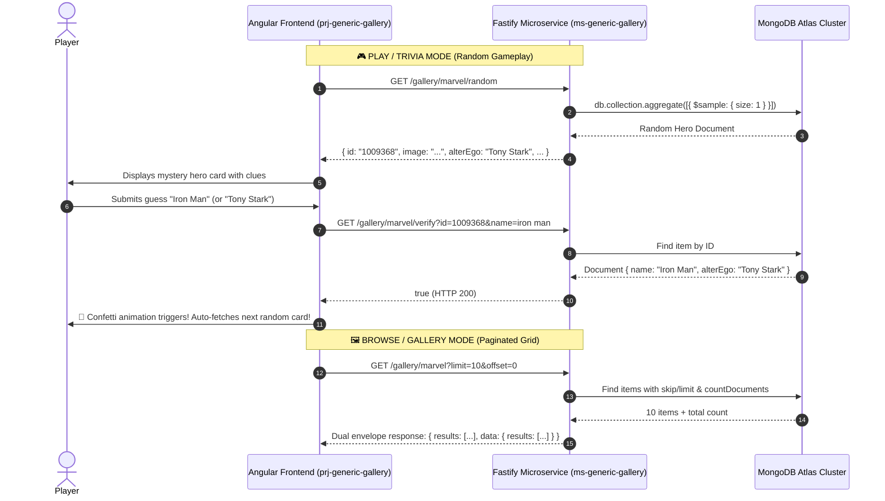

# ms-generic-gallery

[](https://nodejs.org/)
[](https://fastify.io/)
[](https://www.typescriptlang.org/)
[](http://localhost:3000/documentation)
[]()
[](https://opensource.org/licenses/ISC)

A high-performance, modular REST microservice built with **Node 24**, **Fastify 5**, **TypeScript**, and **MongoDB Atlas**. Designed to power multimedia galleries, paginated collections, fuzzy keyword search, and real-time interactive guessing/trivia games.

Serves as the dedicated backend for [**prj-generic-gallery**](https://github.com/himanshusaraswat/prj-generic-gallery) (Angular 19 + Signals).

---

## Interactive Swagger / OpenAPI Documentation

Interactive OpenAPI 3.0 documentation and an in-browser live test console are built directly into the microservice:

- **Swagger UI Console**: [http://localhost:3000/documentation](http://localhost:3000/documentation)
- **OpenAPI Schema**: [http://localhost:3000/documentation/json](http://localhost:3000/documentation/json)

You can inspect all request schemas, query parameters, response contracts, and test live queries against your MongoDB cluster directly inside the browser using Swagger's **"Try it out"** button.

---

## System Architecture & Game Flow

The microservice supports both standard paginated browsing and dynamic trivia/guessing gameplay:



---

## API Endpoints

### 1. Deep Healthcheck
```http
GET /
```
Performs a live ping (`db.command({ ping: 1 })`) to the MongoDB Atlas cluster, verifies connectivity, and returns process health and uptime.

**Response**: `200 OK`
```json
{
  "status": "ok",
  "service": "ms-generic-gallery",
  "database": {
    "connected": true,
    "status": "online",
    "name": "generic-gallery",
    "pingMs": 14
  },
  "uptime": 128.45,
  "timestamp": "2026-11-08T22:50:00.000Z"
}
```

---

### 2. Paginated Gallery
```http
GET /gallery/:category?limit=10&offset=0
```
Returns paginated multimedia cards for any collection (e.g. `/gallery/marvel`, `/gallery/nfl`). Features a dual-envelope response format (`results` and `data.results`) for seamless compatibility with Angular Signals and classic REST clients.

**Parameters**:
- `category` *(path, required)*: Collection name (`marvel`, `nfl`)
- `limit` *(query, default: 10)*: Number of items per page
- `offset` *(query, default: 0)*: Number of items to skip

**Response**: `200 OK`
```json
{
  "count": 269,
  "next": "/gallery/marvel?limit=10&offset=10",
  "previous": null,
  "results": [
    {
      "id": "1009368",
      "name": "Iron Man",
      "alterEgo": "Tony Stark",
      "image": "https://cdn.jsdelivr.net/.../iron-man.jpg",
      "thumbnail": {
        "path": "https://cdn.jsdelivr.net/.../iron-man",
        "extension": "jpg"
      }
    }
  ],
  "data": {
    "offset": 0,
    "limit": 10,
    "total": 269,
    "count": 10,
    "results": [ ... ]
  }
}
```

---

### 3. Random Item (Guessing Game & Trivia)
```http
GET /gallery/:category/random
```
Fetches a single random character or player using MongoDB's optimized `$sample: { size: 1 }` pipeline. Eliminates repetitive alphabetical sequences and guarantees infinite replayability without boundary errors.

**Response**: `200 OK`
```json
{
  "id": "1009368",
  "name": "Iron Man",
  "alterEgo": "Tony Stark",
  "image": "https://cdn.jsdelivr.net/.../iron-man.jpg",
  "thumbnail": {
    "path": "https://cdn.jsdelivr.net/.../iron-man",
    "extension": "jpg"
  },
  "category": "marvel"
}
```

---

### 4. Guess Verification
```http
GET /gallery/:category/verify?id=<ITEM_ID>&name=<GUESS>
```
Secure server-side validation for guessing games. Validates guesses case-insensitively with automatic whitespace trimming against both the item's primary name and alter ego (e.g., matching both "Tony Stark" and "Iron Man").

**Response**: `200 OK`
```json
true
```

---

### 5. Fuzzy Keyword Search
```http
GET /gallery/:category/search?q=<KEYWORD>&limit=10&offset=0
```
Performs regex-based case-insensitive search across item names with pagination.

**Response**: `200 OK`
```json
{
  "count": 1,
  "results": [
    {
      "id": "1009610",
      "name": "Spider-Man (Peter Parker)",
      "alterEgo": "Peter Parker",
      "image": "https://cdn.jsdelivr.net/.../spiderman.jpg"
    }
  ]
}
```

---

## Quickstart & Local Development

### 1. Clone & Install
```bash
git clone https://github.com/himanshusaraswat/ms-generic-gallery.git
cd ms-generic-gallery
npm install
```

### 2. Configure Environment
Copy `.env.example` to `.env`:
```bash
cp .env.example .env
```
Populate `.env` with your MongoDB Atlas credentials:
```env
DB_USER=generic-gallery-read-only
DB_PASS=your_secure_password
DB_NAME=generic-gallery
DB_HOST=hs-dev-cluster.tuponkw.mongodb.net
PORT=3000
```
> **Graceful Offline Fallback**: If MongoDB Atlas is unreachable or offline, Fastify automatically falls back to an in-memory development store so the server boots smoothly without crashing.

### 3. Run Automated Tests
- **Unit Test Suite** (Sub-second in-memory tests with `node:test`):
  ```bash
  npm test
  ```
- **Live Server Test Suite** (End-to-end testing against active server and live MongoDB):
  ```bash
  npm run test:live
  ```

### 4. Start Development Server
```bash
npm run dev
```
- API Server: [http://localhost:3000](http://localhost:3000)
- Interactive Swagger UI: [http://localhost:3000/documentation](http://localhost:3000/documentation)

---

## Cloud Deployment (Google Cloud Platform)

Configured for **Google App Engine** and **Google Cloud Run** with Node 24:
```bash
gcloud app deploy app.yml
```

Automated CI/CD runs via GitHub Actions on merge to `develop` ([`.github/workflows/deploy-to-dev-stg-on-develop-merge.yml`](.github/workflows/deploy-to-dev-stg-on-develop-merge.yml)).

---

## License
ISC © [Himanshu Saraswat](https://github.com/himanshusaraswat)
